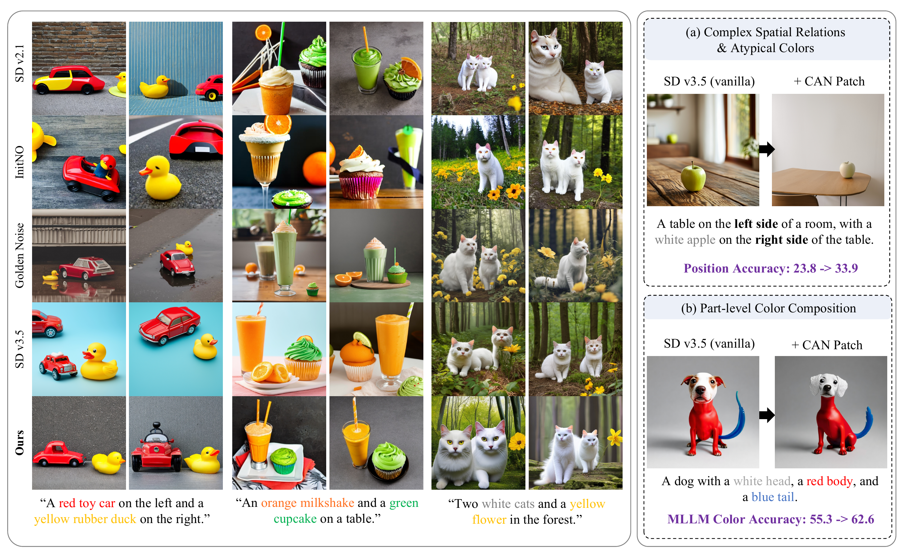
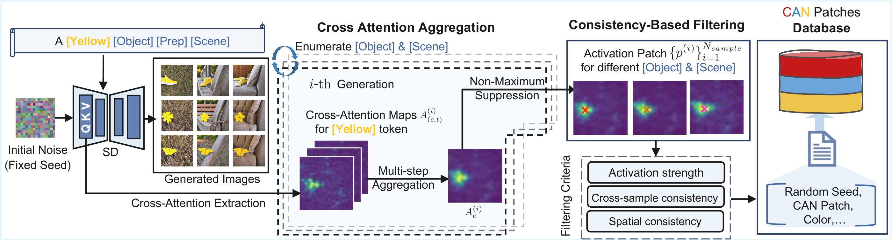
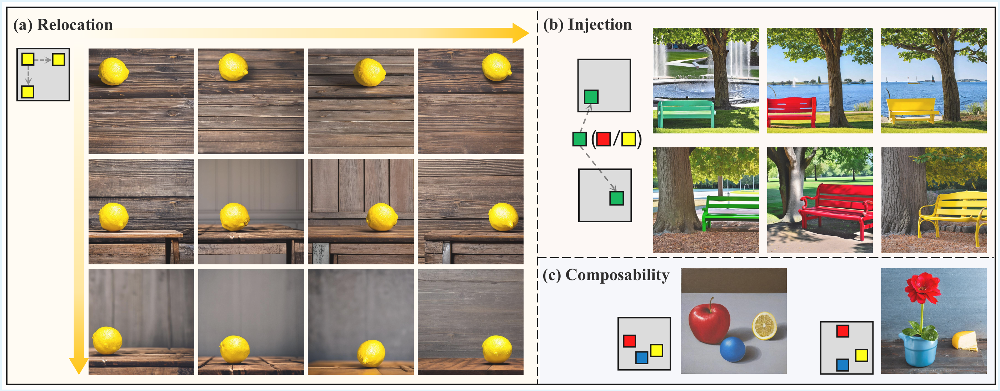
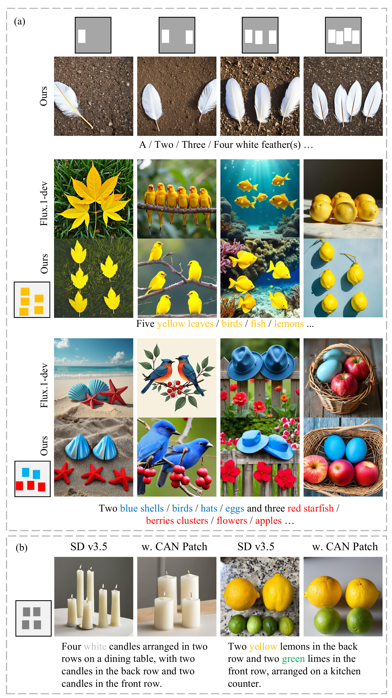
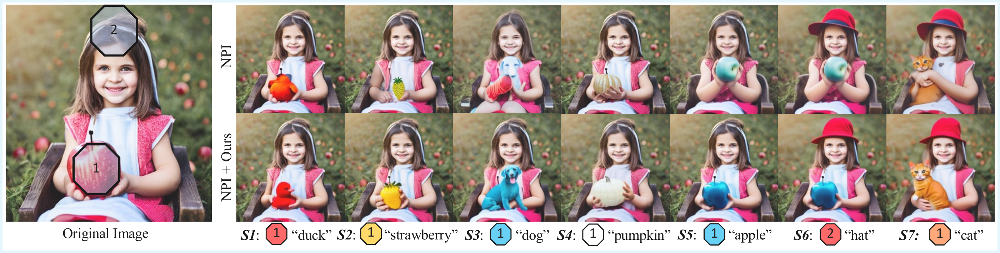

# Steering Diffusion Models via Color-Activating Noise Patches for Controllable Image Synthesis

**Rongjin Guo, Ke Xu, and Rynson W. H. Lau**

ACM Transactions on Graphics / SIGGRAPH Asia 2026 · [Paper](https://doi.org/10.1145/3842498)

## Overview

We identify Color-Activating Noise (CAN) patches: local regions of initial Gaussian
noise that consistently respond to specific color tokens and guide object placement.
Mined from a pretrained diffusion model, these patches form a reusable database
for color and position control without additional training or optimization.
CAN patches support atypical and multi-color generation, interactive editing,
and counting-aware synthesis.

## Results

Overview:



Mining pipeline:



Color and position control:



Counting:

<p align="center">
  <a href="assets/object_count_control.png"></a>
</p>

Interactive editing:



*Figures show results from the paper.*

## Install

Python 3.10+ and PyTorch for your CUDA environment:

```bash
pip install -e ".[inference]"
```

Default model: `stabilityai/stable-diffusion-2-1`. Use
`--model /path/to/sd21 --local-files-only` for a local model directory.

## Usage

Application configurations are provided in `examples/` for color and position
control, object counting, interactive editing, and batch generation.

```bash
# Build the CAN patch database.
can-patches build-db --output data/patches/can

# Color and position control: a red ball on the left and a blue cube on the right.
can-patches generate --database data/patches/can --layout examples/red_blue.json --output outputs/composition.png

# Object counting: generate configurations requesting 1–5 red balls.
can-patches count --config examples/counting/red_balls.json --database data/patches/can --output-dir outputs/counting

# Interactive editing: change an apple from red to blue.
can-patches invert --image source.png --source-prompt "A girl holding a red apple." --output-dir outputs/inversion
can-patches edit --inversion outputs/inversion --mask mask.png --database data/patches/can --config examples/editing/recolor_blue_apple.json --output outputs/edit.png

# Batch generation: 24 images across colors, objects, scenes, and seeds.
can-patches mine-generate --config examples/mining/batch_generation.json --output-dir outputs/mining
```

For editing, supply `source.png` and a `mask.png` with white marking the edit
region and black marking the preserved region. Use `can-patches mask --help`
for mask preparation. Additional editing configurations cover object replacement
and addition; counting configurations include single- and mixed-color objects.

Single- and multi-color prompt datasets are provided in `datasets/prompts/`.
Use `--help` on any command for its options.

## License

The source code is licensed under the [MIT License](LICENSE).
